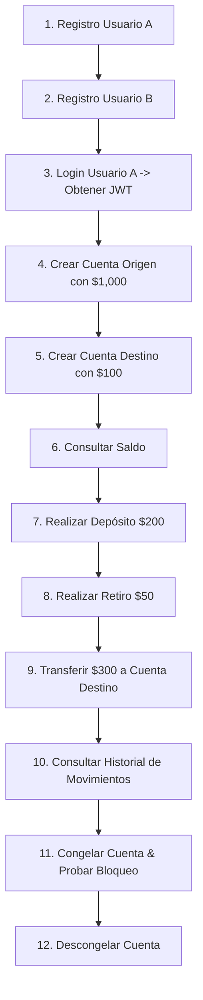

# 🚀 Guía Paso a Paso para Pruebas en Postman (Fintech Core API)

Esta guía te explica detalladamente cómo levantar el entorno y probar cada uno de los endpoints de la API REST utilizando **Postman**.

---

## ⚙️ 1. Preparación del Entorno

Antes de realizar peticiones, asegúrate de tener la base de datos y la aplicación ejecutándose:

1. **Iniciar la Base de Datos PostgreSQL (Docker)**:
   ```bash
   docker compose up -d
   ```
2. **Aplicar las migraciones de Prisma**:
   ```bash
   pnpm exec prisma db push
   ```
3. **Iniciar el Servidor**:
   ```bash
   pnpm start
   ```
   > Deberás ver en la terminal:  
   > `🚀 Fintech Core App API ejecutándose exitosamente en http://localhost:3000`

---

## 🌐 Configuración Base en Postman

* **Base URL**: `http://localhost:3000`
* **Headers Globales**:
  * `Content-Type: application/json`
* **Autenticación en Rutas Protegidas**:
  * Tipo: **Bearer Token**
  * Token: `<Pega aquí el token obtenido en el Login>`

---

## 📋 Flujo de Pruebas Recomendado (Paso a Paso)



---

### Paso 1: Registrar Usuario A (Remitente)
* **Método**: `POST`
* **URL**: `http://localhost:3000/api/auth/register`
* **Body** (raw -> JSON):
```json
{
  "email": "carlos.mendoza@fintech.com",
  "password": "Password123#",
  "fullName": "Carlos Mendoza"
}
```
* **Respuesta Esperada** (`201 Created`):
```json
{
  "status": "success",
  "data": {
    "id": "uuid-del-usuario-a",
    "email": "carlos.mendoza@fintech.com",
    "fullName": "Carlos Mendoza",
    "status": "ACTIVE",
    "createdAt": "2026-11-02T..."
  }
}
```

---

### Paso 2: Registrar Usuario B (Destinatario)
* **Método**: `POST`
* **URL**: `http://localhost:3000/api/auth/register`
* **Body** (raw -> JSON):
```json
{
  "email": "laura.gomez@fintech.com",
  "password": "Password123#",
  "fullName": "Laura Gomez"
}
```
* **Respuesta Esperada** (`201 Created`).

---

### Paso 3: Iniciar Sesión (Login) con Usuario A
* **Método**: `POST`
* **URL**: `http://localhost:3000/api/auth/login`
* **Body** (raw -> JSON):
```json
{
  "email": "carlos.mendoza@fintech.com",
  "password": "Password123#"
}
```
* **Respuesta Esperada** (`200 OK`):
```json
{
  "status": "success",
  "data": {
    "id": "uuid-del-usuario-a",
    "email": "carlos.mendoza@fintech.com",
    "fullName": "Carlos Mendoza",
    "status": "ACTIVE",
    "token": "eyJhbGciOiJIUzI1NiIsInR5cCI6IkpXVCJ9..."
  }
}
```
> ⚠️ **IMPORTANTE**: Copia el valor de `"token"`. Lo usarás en la pestaña **Authorization -> Bearer Token** para todos los siguientes pasos.

---

### Paso 4: Crear Cuenta Bancaria (Usuario A)
* **Método**: `POST`
* **URL**: `http://localhost:3000/api/accounts`
* **Authorization**: Bearer `<TOKEN_USUARIO_A>`
* **Body** (raw -> JSON):
```json
{
  "initialBalance": 1000.00
}
```
* **Respuesta Esperada** (`201 Created`):
```json
{
  "status": "success",
  "data": {
    "id": "uuid-cuenta-a",
    "accountNumber": "ACC-123456789",
    "balance": "1000",
    "status": "ACTIVE",
    "userId": "uuid-del-usuario-a",
    "createdAt": "..."
  }
}
```
> Copia el `"id"` de esta cuenta. Será tu **Cuenta Origen**.

---

### Paso 5: Crear Cuenta Destino (Usuario B)
1. Haz login con `laura.gomez@fintech.com` para obtener su token.
2. Crea una cuenta con su token:
* **Método**: `POST`
* **URL**: `http://localhost:3000/api/accounts`
* **Authorization**: Bearer `<TOKEN_USUARIO_B>`
* **Body**:
```json
{
  "initialBalance": 100.00
}
```
> Copia el `"id"` de esta cuenta. Será tu **Cuenta Destino**.
*(Para los pasos siguientes vuelve a usar el token de Carlos / Usuario A).*

---

### Paso 6: Listar Cuentas del Usuario Autenticado
* **Método**: `GET`
* **URL**: `http://localhost:3000/api/accounts`
* **Authorization**: Bearer `<TOKEN_USUARIO_A>`
* **Respuesta Esperada** (`200 OK`): Retorna una lista con las cuentas pertenecientes a Carlos.

---

### Paso 7: Consultar Saldo de la Cuenta
* **Método**: `GET`
* **URL**: `http://localhost:3000/api/accounts/:accountId/balance`
  *(Reemplaza `:accountId` por el ID de la Cuenta A)*
* **Authorization**: Bearer `<TOKEN_USUARIO_A>`
* **Respuesta Esperada** (`200 OK`):
```json
{
  "status": "success",
  "data": {
    "id": "uuid-cuenta-a",
    "accountNumber": "ACC-123456789",
    "balance": "1000",
    "status": "ACTIVE",
    "userId": "...",
    "createdAt": "..."
  }
}
```

---

### Paso 8: Realizar un Depósito
* **Método**: `POST`
* **URL**: `http://localhost:3000/api/transactions/deposit`
* **Authorization**: Bearer `<TOKEN_USUARIO_A>`
* **Body** (raw -> JSON):
```json
{
  "accountId": "uuid-cuenta-a",
  "amount": 250.00
}
```
* **Respuesta Esperada** (`200 OK`):
```json
{
  "status": "success",
  "message": "Depósito aplicado exitosamente.",
  "data": {
    "accountId": "uuid-cuenta-a",
    "accountNumber": "ACC-123456789",
    "newBalance": "1250",
    "status": "ACTIVE"
  }
}
```

---

### Paso 9: Realizar un Retiro
* **Método**: `POST`
* **URL**: `http://localhost:3000/api/transactions/withdraw`
* **Authorization**: Bearer `<TOKEN_USUARIO_A>`
* **Body** (raw -> JSON):
```json
{
  "accountId": "uuid-cuenta-a",
  "amount": 50.00
}
```
* **Respuesta Esperada** (`200 OK`):
```json
{
  "status": "success",
  "message": "Retiro ejecutado exitosamente.",
  "data": {
    "accountId": "uuid-cuenta-a",
    "accountNumber": "ACC-123456789",
    "newBalance": "1200",
    "status": "ACTIVE"
  }
}
```

---

### Paso 10: Realizar una Transferencia entre Cuentas
* **Método**: `POST`
* **URL**: `http://localhost:3000/api/transactions/transfer`
* **Authorization**: Bearer `<TOKEN_USUARIO_A>`
* **Body** (raw -> JSON):
```json
{
  "sourceAccountId": "uuid-cuenta-a",
  "destinationAccountId": "uuid-cuenta-b",
  "amount": 300.00
}
```
* **Respuesta Esperada** (`201 Created`):
```json
{
  "status": "success",
  "message": "Transferencia ejecutada de forma satisfactoria.",
  "data": {
    "transactionId": "uuid-transaccion",
    "sourceAccountId": "uuid-cuenta-a",
    "destinationAccountId": "uuid-cuenta-b",
    "amount": 300,
    "executedAt": "2026-11-02T..."
  }
}
```

---

### Paso 11: Consultar Historial de Transacciones
* **Método**: `GET`
* **URL**: `http://localhost:3000/api/transactions/history/:accountId`
  *(Reemplaza `:accountId` por el ID de la Cuenta A)*
* **Authorization**: Bearer `<TOKEN_USUARIO_A>`
* **Respuesta Esperada** (`200 OK`): Lista cronológica con el depósito, retiro y transferencia realizados.

---

### Paso 12: Congelar Cuenta (Seguridad)
* **Método**: `PATCH`
* **URL**: `http://localhost:3000/api/accounts/:accountId/freeze`
* **Authorization**: Bearer `<TOKEN_USUARIO_A>`
* **Respuesta Esperada** (`200 OK`):
```json
{
  "status": "success",
  "message": "Cuenta congelada exitosamente.",
  "data": {
    "accountId": "uuid-cuenta-a",
    "accountNumber": "ACC-123456789",
    "status": "FROZEN"
  }
}
```

---

### Paso 13: Prueba de Bloqueo (Cuenta Congelada)
Intenta volver a transferir o retirar desde la Cuenta A mientras está congelada:
* **Método**: `POST` a `/api/transactions/withdraw` con monto `50.00`
* **Respuesta Esperada** (`403 Forbidden`):
```json
{
  "status": "error",
  "code": "OPERATION_FORBIDDEN",
  "message": "Alerta de seguridad: La cuenta [...] se encuentra congelada."
}
```

---

### Paso 14: Reactivar (Descongelar) Cuenta
* **Método**: `PATCH`
* **URL**: `http://localhost:3000/api/accounts/:accountId/unfreeze`
* **Authorization**: Bearer `<TOKEN_USUARIO_A>`
* **Respuesta Esperada** (`200 OK`): Estado vuelve a `"ACTIVE"`.

